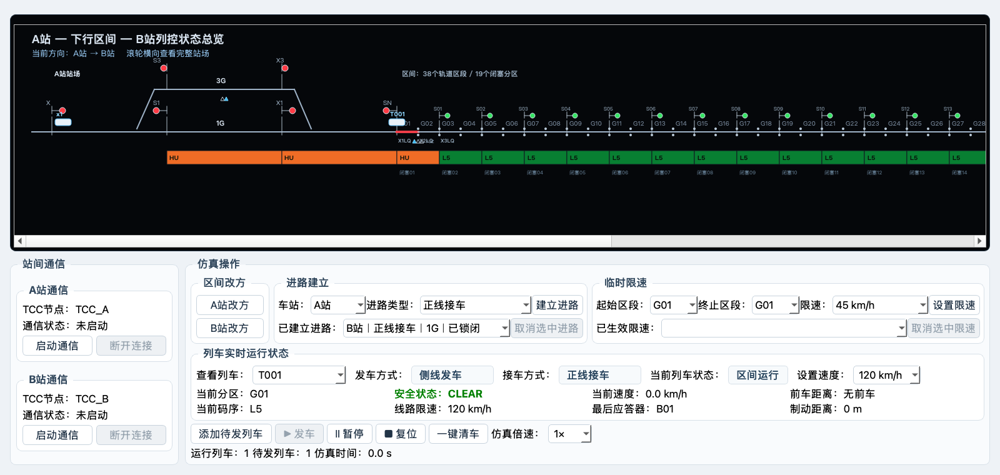

# 阶段 5 增量技术说明：进路生命周期与站内连续运行

## 本次目标

本次修订把发车进路和接车进路拆成两个独立阶段。列车只要具备当前方向对应的发车进路即可发车；接车进路允许稍后建立，并且只分配给同方向最靠近目标站、尚未获得接车进路的列车。

既有 38 个区间轨道区段、19 个闭塞分区、多车追踪防护、临时限速、通信门禁和站场物理设备位置保持不变。

## 进路生命周期

### 发车进路

- A→B 使用 A站发车进路，B→A 使用 B站发车进路。
- 发车方式不再由操作者下拉选择，而是由实际建立的正线或侧线发车进路派生。
- 列车进入首个区间轨道区段后，发车进路立即删除。
- 下一辆待发列车必须重新建立发车进路，并满足入口空闲和前车间隔条件后才能发车。

### 接车进路

- A→B 使用 B站接车进路，B→A 使用 A站接车进路。
- 新建接车进路自动分配给当前方向最前方、尚未绑定接车进路的活动列车。
- 后车不会共享前车的接车进路；前车进路释放后，必须人工为后车重新建立。
- A→B 列车越过 B站 X1/X3 后删除接车进路；B→A 列车越过 A站 S1/S3 后删除接车进路。
- 删除接车进路后列车继续穿越站场，直至越过目标站另一端外方信号机才转为“已到达”。

## 无接车进路时的停车

- A→B 列车在 G38 末端、B站进站边界前停车。
- B→A 列车在 G01 末端、A站进站边界前停车。
- 停车状态标记为“等待接车进路”，不会被普通区段空闲检测误恢复。
- 建立合法接车进路后，系统只恢复最前方等待列车；全局暂停时保持停车，继续仿真后才移动。

## 多车规则

两辆及以上列车可以同时在区间运行，但每辆车必须独立消耗一条发车进路和一条接车进路。接车进路始终按区间累计位置分配给最前车，后车到达站外边界时若没有自己的接车进路就停车。

端到端回归同时覆盖 A→B 与 B→A：

1. 第一辆车用正线发车进路发车，进路自动删除。
2. 重建侧线发车进路，第二辆车在满足间隔后发车。
3. 第一辆车到达站外并等待，建立正线接车进路后恢复。
4. 第二辆车到达站外，不能复用第一辆车的接车进路。
5. 第一辆车越过内方信号机后接车进路删除，并继续驶出车站。
6. 为第二辆车重建侧线接车进路，第二辆车恢复、进站并驶出。

## 状态区与 2D 显示

状态区首行依次为：

“查看列车｜发车方式｜接车方式｜当前列车状态｜设置速度”

下方固定为两行四列：

| 第一状态行 | 第二状态行 |
|---|---|
| 当前分区 | 当前码序 |
| 安全状态 | 线路限速 |
| 当前速度 | 最后应答器 |
| 前车距离 | 制动距离 |

“发车方式”和“接车方式”是只读状态，不存在相应进路时显示“发车进路尚未建立”或“接车进路尚未建立”。等待接车、接车、站内运行、驶出站场和已到达均有明确状态文字。

2D 图中，A→B 待发列车位于 A站 X 信号机右侧，B→A 待发列车位于 B站 S 信号机左侧，并按待发顺序显示 x1、x2…。运行列车会连续显示在区间、目标站接车进路、站内股道及出站侧。

四类进路白光带端点为：

| 方向 | 类型 | 白光带范围 |
|---|---|---|
| A→B | 发车 | X1—SN 或 X3—SN |
| A→B | 接车 | X—X1 或 X—X3 |
| B→A | 发车 | S1—X 或 S3—X |
| B→A | 接车 | SN—S1 或 SN—S3 |

## 验证结果

- 双方向双车端到端测试通过。
- 全量回归：121 项全部通过。
- Python 语法与字节码检查：models、services、ui、tests 全部通过。
- 差异格式检查：git diff --check 无错误。
- 1600×760 离屏截图确认：首行五项、两行四列状态、三操作板块和 2D 图均无文字覆盖或控件裁切。

## 中断后恢复

恢复工作时先阅读根目录 PROGRESS.md 和本文件，然后执行：

1. 检查 Git 工作区状态。
2. 以离屏模式运行全部单元测试。
3. 对 models、services、ui、tests 执行 Python 编译检查。

若三项均通过，则本次进路生命周期修订已经完成。后续功能不得恢复“发车前必须同时存在接车进路”的旧逻辑，也不得让多辆列车共享同一条接车进路。
