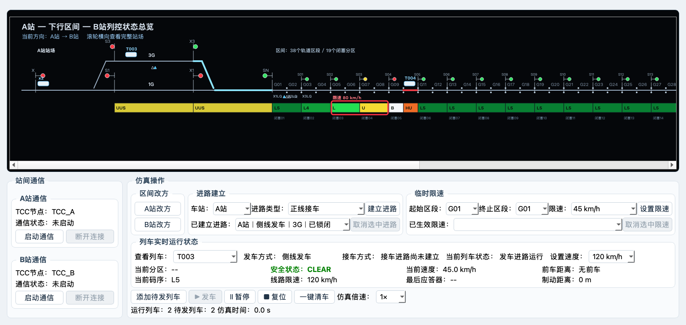

# 阶段 06：站内连续路径、码序信号与彻底复位

## 1. 本阶段范围

本阶段完成了以下联动闭环：

- 待发列车在出发端聚合为一个 `xN` 标记，不重复绘制车辆；
- 列车发车后先进入 `DEPARTING` 站内阶段，从 X 右侧或 S 左侧沿真实正线/侧线进路运行，越过站界后才占用 G01/G38；
- 侧线列车按完整折线路径长度插值，连续经过斜坡和 3G，不发生位置跳变；
- A/B 站内六架信号和区间 S01～S18 全部由业务层轨道码序快照驱动，绘图层不再写死灯色；
- 发车方式、接车方式、当前列车状态使用普通纯文本显示；
- 全局复位清空全部进路和列车接发配置，列车回到待发点，同时保留最大速度与临时限速；
- 增加 A→B/B→A × 正线/侧线四组合及多车码序、信号、待发数量联合回归。

## 2. 关键接口

### 2.1 列车与路径

- `Train.enter_departure(route_id, track, initial_position=0.0)`：进入站内发车阶段，不提前占用区间。
- `TrainService.handle_departure_transition(train)`：列车越过站界后进入 G01/G38，读取入口应答器并释放已使用的发车进路。
- `TccOverviewWidget.waiting_marker_contracts(trains)`：按出发端聚合待发列车，返回一个 `xN` 标记。
- `TccOverviewWidget.station_train_path(station, direction, track, rail_y)`：输出正线或侧线物理折线路径。
- `TccOverviewWidget.interpolate_path(points, progress)`：按路径总长度插值站内列车位置。

### 2.2 信号快照

- `SimulationService.aspect_for_code(code)`：唯一的码序—灯色映射；空值和非法码按红灯处理。
- `SimulationService.get_station_signal_aspects()`：根据方向、活动进路、1G/3G/THROAT 码序及入口占用返回本站六架信号快照。
- `SimulationService.get_interval_signal_aspects()`：A→B 时 S01～S18 分别读取前方闭塞分区两个轨道区段中的最限制码；B→A 时固定向右信号全部红灯。
- `TccOverviewWidget.set_state(..., station_signals=..., interval_signals=...)`：只消费业务快照，缺失信号默认红灯。

码序与灯色映射：

| 码序 | 灯色 |
|---|---|
| L5、L4、L3、L2、L | 绿灯 |
| LU | 黄绿灯 |
| U | 黄灯 |
| UUS | L灯 |
| HU、空值、非法值 | 红灯 |

### 2.3 全局复位

- `Train.reset_to_departure(preserve_configuration=False)`：清空接发方式、股道、进路绑定和运行状态，但保留列车最大速度。
- `TrainService.reset_dispatched_trains(clear_routes=True)`：默认复位全部运行、暂停和已到达列车，并调用 `RouteService.clear_all()` 删除全部已建立/锁闭进路。
- `clear_routes=False` 仅作为兼容入口，显式调用时保留原配置并解除锁闭。
- `MainWindow.reset_simulation()` 的顺序为：暂停引擎 → 复位列车/进路 → 同步 B 站占用 → 重算两站码序与信号 → 仿真时钟归零 → 刷新进路控件和全图。

临时限速服务不参与复位，因此已生效限速继续保留。

## 3. 状态机摘要

```text
WAITING
  └─ 发车进路满足 → DEPARTING（站内路径）
       └─ 越过站界 → INTERVAL_RUNNING（G01/G38起）
            └─ 无接车进路 → WAITING_RECEIVE_ROUTE（目标站外停车）
            └─ 获得接车进路 → RECEIVING
                 └─ 越过内方信号 → STATION_RUNNING（接车进路释放）
                      └─ 接近外方信号 → EXITING
                           └─ 驶出车站 → ARRIVED
```

正线与侧线使用同一状态机，只是站内路径分别取 1G 直线或 3G 折线。

## 4. 验证结果

```text
.venv/bin/python -m unittest tests.test_multi_train_dispatch tests.test_route_integration tests.test_phase1_ui -v
Ran 116 tests
OK

.venv/bin/python -m unittest discover -s tests -v
Ran 140 tests
OK

.venv/bin/python -m compileall models services ui tests
成功，退出码 0

git diff --check
无格式错误
```

四组合端到端验证覆盖：

1. A→B 正线发车 + 正线接车；
2. A→B 侧线发车 + 侧线接车；
3. B→A 正线发车 + 正线接车；
4. B→A 侧线发车 + 侧线接车。

每种组合均检查待发 `x1`、站内 `DEPARTING`、不提前占用入口、进入 G01/G38、目标站外等待、按 1G/3G 接车、接车进路释放和最终到达。

## 5. 视觉验收

验收图：



图中场景包含：两个待发列车的单一 `x2` 标记、A站 3G 上的侧线发车列车 T003、G10 区间运行列车 T004、G05～G08 临时限速、动态闭塞码和信号灯。1600×760 下未发现文字遮挡，状态栏三个只读值无框，操作区保持 `1:4:5`。

## 6. 已知限制

- 区间信号按课程仿真的固定向右布置：B→A 时 S01～S18 均红；反方向信号机未单独绘制。
- 信号灯色使用低频码的课程化映射，不等同于真实工程设备的完整联锁数据表。
- 2D 图通过横向滚动查看全线路，1600×760 默认视口不会同时显示 B 站尾端。
- 本阶段不新增日志功能。

## 7. 中断后恢复入口

1. 阅读本文件和根目录 `PROGRESS.md`。
2. 运行 `git status --short --branch`，确认没有未知本地修改。
3. 运行 `.venv/bin/python -m unittest discover -s tests -v`，预期 140 项通过。
4. 若仅存在“本地已提交、远端未同步”，只执行普通 `git push origin main`，禁止强制推送。
5. 后续功能应继续从业务快照扩展，禁止在 `TccOverviewWidget` 内重新硬编码信号灯色或列车运行规则。
